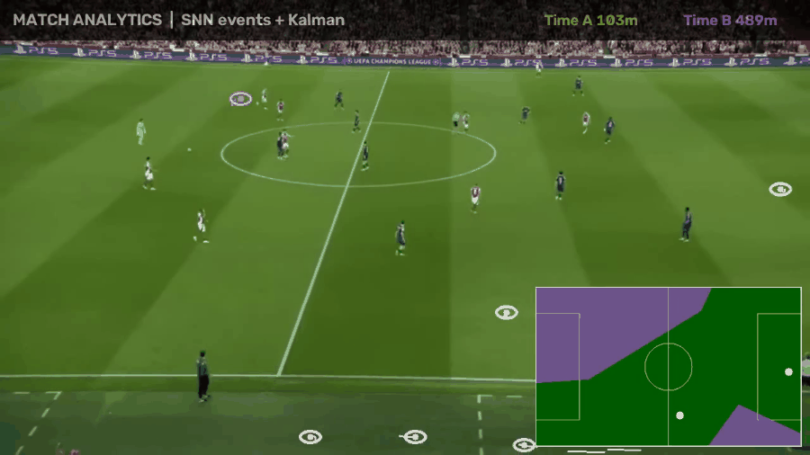

# Match-Analytics

Analytics de partida de futebol com pipeline **100% neuromórfica e feita do zero** — nenhum YOLO, nenhum modelo pré-treinado:

```
video -> DVS events -> clustering (posicoes exatas)
      -> SNN classifica blob: JOGADOR vs ruido (94.9% acc)
      -> Kalman tracking -> kmeans = times -> homografia -> radar 2D
```



## Pipeline

| Etapa | Implementação |
|---|---|
| Eventos | DVS simulado (contraste log-temporal, ref adaptativa) |
| Detecção | **SNN detector** estilo CenterNet: conv-LIF → heatmap de centros + regressão de tamanho. Treinado com **auto-labels**: blobs de eventos viram ground truth, zero anotação manual |
| Tracking | **Filtro de Kalman do zero** (estado [x,y,vx,vy]) por jogador |
| Times | **kmeans do zero** na cor do uniforme (torso, sem verde do campo) |
| Radar | **Homografia calibrada** → posição real em metros no mini-mapa |
| Stats | distância percorrida por time, jogadores em campo, trilhas |

## Resultados (avaliação honesta)

- **SNN classificadora: 94.9% acc** (jogador vs ruído) em ~8k blobs
  auto-rotulados por posição — sem nenhuma anotação manual
- Arquitetura de produção real (mesma de sistemas Prophesee): clustering
  de eventos dá posições exatas, a SNN decide o que é jogador
- Detector end-to-end SNN também implementado (`src/snn_detector.py`,
  CenterNet conv-LIF) — P=0.80/R=0.53 vs pseudo-labels; satura porque
  jogador parado não emite evento — limitação real do paradigma DVS
- Radar 2D com **zonas de controle territorial (Voronoi)** por time
- Distância real percorrida por time (metros, via homografia)

## Uso

```bash
pip install -r requirements.txt

# 1) auto-labels de eventos
python -m src.auto_label raw/clip.mp4

# 2) treina o detector SNN nos pseudo-labels
python -m src.train_detector --epochs 40

# 3) calibra homografia: edite src->dst (metros) em calib_*.json

# 4) demo: partida + radar + stats
python -m src.demo_match raw/clip.mp4 --calib calib_m02.json --use-events
```

## Por que "do zero" importa aqui

O pipeline inteiro — neurônios LIF, surrogate gradient, heatmap decoder, Kalman, kmeans, homografia — é implementado sem frameworks de detecção. É a arquitetura que sistemas neuromórficos de esporte (Prophesee etc.) usam: eventos baratos, latência mínima, computação só onde há movimento.

Série neuromórfica:
[snn-ocr](https://github.com/vsousadelvek/snn-ocr) ·
[snn-gesture](https://github.com/vsousadelvek/snn-gesture) ·
[snn-tracker](https://github.com/vsousadelvek/snn-tracker) ·
[snn-anomaly](https://github.com/vsousadelvek/snn-anomaly) ·
[snn-forecast](https://github.com/vsousadelvek/snn-forecast)
